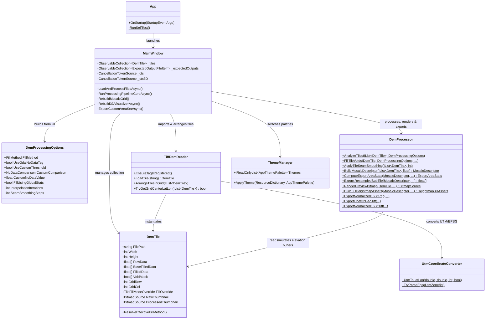
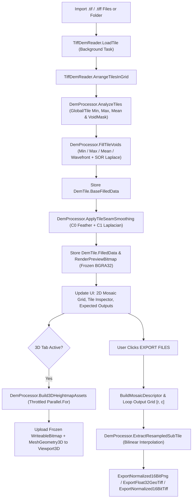

# ARCHITECTURE.md — Technical Reference for DEM Cleaner

This document provides a comprehensive technical reference for the **DEM Cleaner** codebase as verified directly from the source files.

---

## 1. Project Overview

**DEM Cleaner** is a standalone Windows desktop utility built by Sipp Studio for GIS and 3D terrain workflows (including Unreal Engine Landscape, Unity Terrain, and Gaea). It ingests single or tiled Digital Elevation Model (DEM) GeoTIFF files, detects and repairs missing/void elevation data, smooths seams across adjacent tiles, previews the resulting mosaic in 2D and hardware-accelerated 3D, and exports cropped/resampled elevation datasets as 16-bit normalized PNGs or 16-bit/32-bit GeoTIFFs.

### Development Status Summary
- **Verified Implemented**: Multi-file/folder TIFF import (scanline & tiled), GeoTIFF/GDAL tag parsing and writing, automatic 2D grid arrangement (USGS 1m, `x/y`, `r/c`, GeoTIFF tiepoints, alphabetical fallback), void detection & 4 fill algorithms (Minimum, Maximum, Mean, Wavefront + SOR Laplace Interpolation), per-tile fill overrides, 3-pass inter-tile seam smoothing, interactive 2D mosaic viewport with zoom/pan and square export region gizmo, Before/After tile inspector, GPU 3D heightmap visualizer (1K–16K, 4 color palettes, water shader, wireframe, Z-scale, sun angle), expected output file table, multi-format/multi-layout bilinear export, 6 dynamic color themes, and Google Earth / Google Maps coordinate launch.
- **Inferred / Partial / Remnant Elements**:
  - [`MainWindow.SyncGridDimensionsBoxes()`](file:///C:/Users/redla/repositories/DEM%20Cleaner/MainWindow.xaml.cs#L832-L834) is an empty method body called after grid arrangement and DataGrid cell edits—inferred to be a leftover hook from an earlier manual grid-dimension UI.
  - [`App.RunSelfTest()`](file:///C:/Users/redla/repositories/DEM%20Cleaner/App.xaml.cs#L26-L45) implements a minimal smoke check (`FillMethod.Minimum` default and theme count) triggered via `--self-test`.
  - [icon.ico](file:///C:/Users/redla/repositories/DEM%20Cleaner/icon.ico) and [icon3.ico](file:///C:/Users/redla/repositories/DEM%20Cleaner/icon3.ico) exist in the repository root alongside the active [icon2.ico](file:///C:/Users/redla/repositories/DEM%20Cleaner/icon2.ico) referenced by [DemCleaner.csproj](file:///C:/Users/redla/repositories/DEM%20Cleaner/DemCleaner.csproj#L9-L13).

---

## 2. Technology Stack

| Layer | Technology / Library | Details |
| :--- | :--- | :--- |
| **Runtime & SDK** | `.NET 8.0` (`net8.0-windows`) | C# 12, `<Nullable>enable</Nullable>`, `<ImplicitUsings>enable</ImplicitUsings>` |
| **UI Framework** | Windows Presentation Foundation (`WPF`) | XAML custom control templates, `DynamicResource` theming, `Viewport3D` (Direct3D 9 interop) |
| **TIFF / GeoTIFF I/O** | `BitMiracle.LibTiff.NET` (`2.4.660`) | Pure managed LibTiff port (`BitMiracle.LibTiff.Classic`) with custom tag extender |
| **PNG Imaging** | `System.Windows.Media.Imaging` | `PngBitmapEncoder` with `PixelFormats.Gray16` (`ushort[]`) |
| **Concurrency** | `Task.Run` + `Parallel.For` + `CancellationTokenSource` | Background compute pipelines with thread-throttled parallel loops |

---

## 3. Directory & File Structure

```text
DEM Cleaner/
├── App.xaml                        # WPF Application definition (StartupUri="MainWindow.xaml")
├── App.xaml.cs                     # Application startup & "--self-test" CLI mode handler
├── AssemblyInfo.cs                 # WPF ThemeInfo assembly attribute
├── DemCleaner.csproj               # .NET 8 WPF project file, LibTiff package ref, Debug PostBuild hook
├── DemCleaner.slnx                 # XML-format Visual Studio solution file
├── LICENSE.txt                     # Sipp Studio proprietary license (copied to output directory)
├── MainWindow.xaml                 # Primary UI layout, custom control styles, 2D/3D viewports (1,463 lines)
├── MainWindow.xaml.cs              # UI state, event handlers, 2D overlay gizmo, 3D camera & pipelines (3,556 lines)
├── icon2.ico                       # Active application icon (icon.ico and icon3.ico are unused)
├── Models/
│   └── DemTile.cs                  # DemTile (INotifyPropertyChanged), DemProcessingOptions, ExpectedOutputFileItem, enums
└── Services/
    ├── DemProcessor.cs             # Void detection/fill, seam smoothing, virtual mosaic, 3D builder, exporters (1,877 lines)
    ├── ThemeManager.cs             # AppThemePalette record and 6 runtime color themes
    ├── TiffDemReader.cs            # TIFF/GeoTIFF reader, custom tag extender, filename parser, grid arranger
    └── UtmCoordinateConverter.cs   # WGS84/NAD83 UTM-to-LatLon math and EPSG PCS code parser
```

---

## 4. Major Components & Relationships



### Component Responsibilities

1. **[`MainWindow`](file:///C:/Users/redla/repositories/DEM%20Cleaner/MainWindow.xaml.cs)**:
   - Owns the observable `_tiles` and `_expectedOutputs` collections bound to `DgTiles` and `DgExpectedOutputs`.
   - Manages interactive 2D viewport state: mouse-wheel zoom (`ScaleGridMosaic`, $1\times$ to $10\times$), right/middle-drag pan, left-drag custom 1:1 square export region (`_exportNormX0..Y1`), center translation gizmo (`RenderTransformGizmo`), and double-click tile inspection.
   - Manages 3D viewport camera state (`_camYawDeg`, `_camPitchDeg`, `_camDistance`, `_camTarget`), sun azimuth lighting (`Light3DMain`), and automatic or manual Z-scale (`Scale3DTerrain.ScaleY`).
   - Coordinates asynchronous background tasks via `_cts` (tile import, void fill, seam smoothing, file export) and `_cts3D` (3D mesh/texture generation).

2. **[`DemTile`](file:///C:/Users/redla/repositories/DEM%20Cleaner/Models/DemTile.cs#L44-L227)**:
   - Implements `INotifyPropertyChanged` for live WPF `DataGrid` updates (`GridRow`, `GridCol`, `FillOverride`, `VoidPixelCount`, `VoidPercentage`, `MinElevation`, `MaxElevation`, `ElevationRange`, `Status`, `RawThumbnail`, `ProcessedThumbnail`).
   - Holds three distinct pixel buffers in row-major order (`Height * Width`):
     - `RawData`: Original elevation samples decoded from the TIFF.
     - `BaseFilledData`: Elevation values after void filling, prior to inter-tile seam smoothing.
     - `FilledData`: Final processed elevation values after inter-tile seam smoothing.
   - Holds `VoidMask` (`bool[]`) where `true` marks NoData/void pixels.

3. **[`TiffDemReader`](file:///C:/Users/redla/repositories/DEM%20Cleaner/Services/TiffDemReader.cs)**:
   - Registers custom GeoTIFF tags via `Tiff.SetTagExtender(TagExtender)` in its static constructor.
   - Reads both scanline (`ReadScanlineTiff`) and tiled (`ReadTiledTiff`) TIFFs across `IEEEFP` (32/64-bit), `INT` (8/16/32-bit), and `UINT` (8/16/32-bit) sample formats.
   - Extracts `GDAL_NODATA` (`42113`), `ModelPixelScaleTag` (`33550`), `ModelTiepointTag` (`33922`), `GeoKeyDirectoryTag` (`34735`, specifically `ProjectedCSTypeGeoKey = 3072`), and `GeoAsciiParamsTag` (`34737`).
   - Parses filename coordinates using 3 compiled regular expressions: `UsgsPattern` (`USGS_1M_10_x56y475`), `ExplicitXyPattern` (`x56y475`), and `ExplicitRowColPattern` (`r0_c1` or `y475_x56`).
   - [`ArrangeTilesInGrid`](file:///C:/Users/redla/repositories/DEM%20Cleaner/Services/TiffDemReader.cs#L392-L453) assigns `GridRow` and `GridCol` using a 3-tier priority:
     1. Parsed filename X/Y coordinates (inverting Y for geographic northward coordinates vs. downward `r0_c1` indices).
     2. Distinct GeoTIFF `ModelTiepointTag` X/Y origins (North = row 0).
     3. Alphabetical filename sort into a near-square $\lceil\sqrt{N}\rceil$ grid.

4. **[`DemProcessor`](file:///C:/Users/redla/repositories/DEM%20Cleaner/Services/DemProcessor.cs)**:
   - Stateless static compute engine operating on `DemTile` instances and `MosaicDescriptor`.

5. **[`UtmCoordinateConverter`](file:///C:/Users/redla/repositories/DEM%20Cleaner/Services/UtmCoordinateConverter.cs)**:
   - Converts UTM Easting/Northing meters to WGS84 Latitude/Longitude decimal degrees using series expansion (`WGS84_A = 6378137.0`, `K0 = 0.9996`) and resolves EPSG codes (`26901..26923` NAD83, `6330..6348` NAD83(2011), `32601..32660` WGS84 North, `32701..32760` WGS84 South).

6. **[`ThemeManager`](file:///C:/Users/redla/repositories/DEM%20Cleaner/Services/ThemeManager.cs)**:
   - Provides 6 `AppThemePalette` records (`Sage & Sandstone`, `Topo Buckskin & Olive`, `Canyon & Pine`, `Forest Canopy`, `Desert Mesa`, `Midnight Slate`) and mutates `Window.Resources` with frozen `SolidColorBrush` instances.

---

## 5. Data Flow & Processing Pipelines



### Key Algorithmic Pipelines in `DemProcessor`

1. **Void Pixel Detection ([`IsVoidPixel`](file:///C:/Users/redla/repositories/DEM%20Cleaner/Services/DemProcessor.cs#L60-L88))**:
   A pixel is flagged as void (`VoidMask[i] = true`) if:
   - `float.IsNaN(value)` or `float.IsInfinity(value)`
   - `value <= -1e30f` or `value >= 1e30f` (standard GIS float sentinel such as `-3.4028235e+38`)
   - `UseGdalNoDataTag` is enabled and `|value - GdalNoDataValue| <= max(1e-4, |GdalNoDataValue| * 1e-5)`
   - `UseCustomThreshold` is enabled and `value` matches `CustomNoDataValue` under `<=`, `==` ($\pm 10^{-4}$), or `>=`.

2. **Void Filling ([`FillTileVoids`](file:///C:/Users/redla/repositories/DEM%20Cleaner/Services/DemProcessor.cs#L169-L256) & [`InterpolateVoidsInPlace`](file:///C:/Users/redla/repositories/DEM%20Cleaner/Services/DemProcessor.cs#L556-L686))**:
   - **Constant Fill (`Minimum`, `Maximum`, `Mean`)**: Replaces void pixels with either the per-tile statistic or the global dataset statistic (`FillUsingGlobalStats`).
   - **Interpolated Fill**:
     - *Stage 1 (Wavefront Seeding)*: Propagates known boundary elevations inward into unresolved void pixels using 8-neighbor inverse-distance weights ($1.0$ cardinal, $0.7071$ diagonal) until all connected void pixels are initialized (isolated voids fallback to `tile.MeanElevation`).
     - *Stage 2 (Gauss-Seidel SOR Laplace Relaxation)*: Runs `Math.Clamp(iterations, 10, 1000)` passes over void indices using Successive Over-Relaxation ($\omega = 1.45$) with early convergence exit when `maxDelta < 1e-4f`.

3. **Inter-Tile Seam Smoothing ([`ApplyTileSeamSmoothing`](file:///C:/Users/redla/repositories/DEM%20Cleaner/Services/DemProcessor.cs#L262-L497))**:
   - Restores `FilledData` from `BaseFilledData` before applying smoothing.
   - *Pass 1 (Vertical Seams)* & *Pass 2 (Horizontal Seams)*: Computes boundary difference along shared edges, box-smooths the 1D difference array tangentially (`Smooth1DArray`), and feathers $\pm 0.5 \cdot \Delta$ inward across a `bandWidth = Math.Clamp(smoothingSteps * 3, 2, 64)` pixel band using cubic smoothstep falloff $t^2(3 - 2t)$.
   - *Pass 3 (Cross-Boundary C1 Laplacian Relaxation)*: Runs `Math.Clamp(smoothingSteps, 1, 25)` passes across a neighborhood of radius `Math.Clamp(smoothingSteps + 2, 2, 28)` across shared vertical and horizontal borders (requires adjacent tiles to have matching dimensions).

4. **Virtual Mosaic & Bilinear Resampling ([`BuildMosaicDescriptor`](file:///C:/Users/redla/repositories/DEM%20Cleaner/Services/DemProcessor.cs#L893-L1002) & [`ExtractResampledSubTile`](file:///C:/Users/redla/repositories/DEM%20Cleaner/Services/DemProcessor.cs#L1105-L1155))**:
   - Rather than allocating a stitched array of all tiles in memory, `MosaicDescriptor` records column widths/offsets, row heights/offsets, a 2D `DemTile?[rows, cols]` lookup table, and top-left geographic origin/scale.
   - `ExtractResampledSubTile` maps normalized sub-region coordinates `[subNormX0..subNormX1, subNormY0..subNormY1]` to target `(outWidth, outHeight)` pixel centers using bilinear interpolation across `SampleMosaicPixel`.

5. **3D GPU Heightmap Generation ([`Build3DHeightmapAssets`](file:///C:/Users/redla/repositories/DEM%20Cleaner/Services/DemProcessor.cs#L1238-L1609))**:
   - Maps the 5 UI resolution tiers to distinct texture dimensions and mesh subdivisions:
     - `1K (1024)`: $1024^2$ texture, $64 \times 64$ mesh ($4{,}096$ quads)
     - `2K (2048)`: $2048^2$ texture, $128 \times 128$ mesh ($16{,}384$ quads)
     - `4K (4096)`: $4096^2$ texture, $256 \times 256$ mesh ($65{,}536$ quads)
     - `8K (8192)`: $8192^2$ texture, $512 \times 512$ mesh ($262{,}144$ quads)
     - `16K (16384)`: $8192^2$ texture (Direct3D 9 hardware texture limit) with $1/16384$ sub-pixel bilinear micro-normal sampling, $1024 \times 1024$ mesh ($1{,}048{,}576$ quads)
   - Shades terrain using `EvaluateTerrainColorRamp` (`Hypsometric`, `Grayscale`, `Alpine`, `Desert`), optional multi-ring neighborhood flat-water detection, and optional quad wireframe lines, then builds a solid pedestal skirt (`BuildTerrainSkirtMesh`).

---

## 6. Application Lifecycle, Configuration & Persistence

- **Startup**: `App.OnStartup` checks command-line arguments for `--self-test`. If absent, WPF opens `MainWindow.xaml`.
- **`MainWindow` Initialization**:
  1. Binds `DgTiles` and `DgExpectedOutputs`.
  2. Sets default export folder to `<BaseDirectory>\ExportedPngs` (or `<FirstTileDirectory>\Exported_16Bit_PNG` if the box is cleared before first import).
  3. Populates `ThemeManager.Themes` and applies index `0` (`Sage & Sandstone`).
  4. Loads [LICENSE.txt](file:///C:/Users/redla/repositories/DEM%20Cleaner/LICENSE.txt) into the header tooltip (`LoadLicenseTooltipText`).
  5. Initializes export resolution preset buttons, 3D camera transform, and sun light vector, then sets `_isInitializing = false`.
- **Persistence**:
  - **No user configuration persistence is implemented**. All UI settings (theme, map provider, void detection rules, fill mode, export path) reset to defaults on restart.

---

## 7. Build, Execution & Testing Architecture

- **Build Process**: Standard MSBuild / `.NET SDK` (`Microsoft.NET.Sdk` with `UseWPF=true`).
  - [LICENSE.txt](file:///C:/Users/redla/repositories/DEM%20Cleaner/LICENSE.txt) is copied to the output directory (`PreserveNewest`).
  - **PostBuild Hook**: In `Debug` configuration, [DemCleaner.csproj](file:///C:/Users/redla/repositories/DEM%20Cleaner/DemCleaner.csproj#L23-L25) runs `start "" "$(TargetPath)"`, automatically launching the application after every Debug build.
- **Testing Architecture**:
  - No separate unit test project exists in the solution.
  - [App.xaml.cs](file:///C:/Users/redla/repositories/DEM%20Cleaner/App.xaml.cs#L16-L44) provides an in-app CLI smoke test invoked via `DemCleaner.exe --self-test`, writing `selftest_result.txt` to `AppDomain.CurrentDomain.BaseDirectory`.

---

## 8. Known Technical Limitations & Architectural Decisions

1. **Monolithic UI Controller ([MainWindow.xaml.cs](file:///C:/Users/redla/repositories/DEM%20Cleaner/MainWindow.xaml.cs))**:
   - At 3,556 lines, `MainWindow.xaml.cs` combines view logic, 2D canvas drawing, 3D camera math, scale bar formatting, and export orchestration. Future refactoring should avoid growing this file further when logic can be placed in `Services/`.
2. **In-Memory Elevation Buffers**:
   - Each `DemTile` keeps `RawData` (`float[]`), `BaseFilledData` (`float[]`), `FilledData` (`float[]`), and `VoidMask` (`bool[]`) in RAM simultaneously (~13 bytes/pixel). Loading many high-resolution tiles (e.g., dozens of $10{,}000 \times 10{,}000$ USGS 1m tiles) can consume several gigabytes of memory.
3. **1:1 Square Constraint on Custom Export Areas**:
   - Interactive drag selection (`ApplyDragPointsToExportArea`) and `UpdateExportAreaMetricsAndUi` (`int sidePx = Math.Min(_exportAreaStats.PixelWidth, _exportAreaStats.PixelHeight)`) enforce a 1:1 square pixel aspect ratio whenever `IsCustomExportAreaActive` is `true` (designed for square game-engine heightmaps).
4. **Seam Smoothing Pass 3 Tile Size Constraint**:
   - While Passes 1 and 2 of `ApplyTileSeamSmoothing` resample across tiles of differing resolutions, Pass 3 (Laplacian C1 relaxation) only processes adjacent tile pairs where `Width` and `Height` are identical.
5. **Direct3D 9 Texture Limit in WPF `Viewport3D`**:
   - WPF's `Viewport3D` uses Direct3D 9 under the hood, which caps hardware texture dimensions at $8192 \times 8192$. In `16K` 3D mode, `Build3DHeightmapAssets` uses an $8192 \times 8192$ `WriteableBitmap` combined with $1/16384$ sub-pixel normal sampling and a $1024 \times 1024$ vertex mesh.

