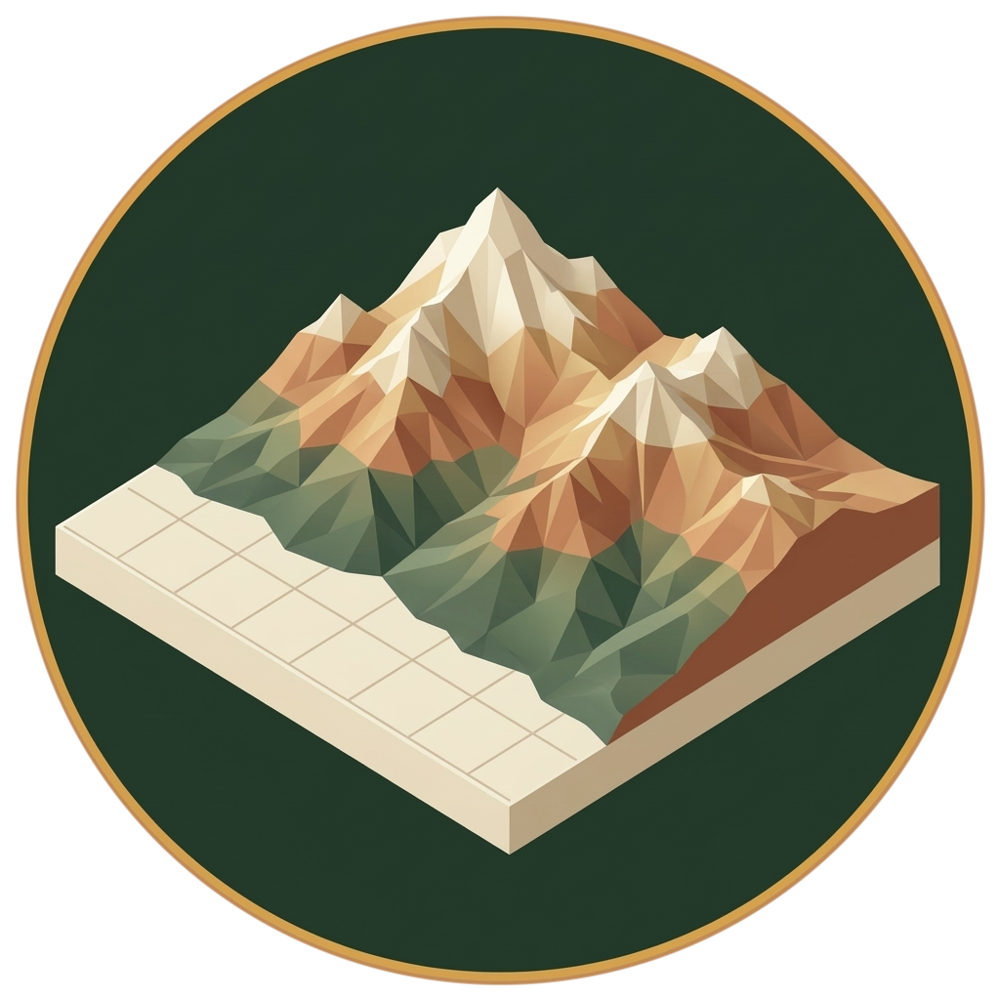
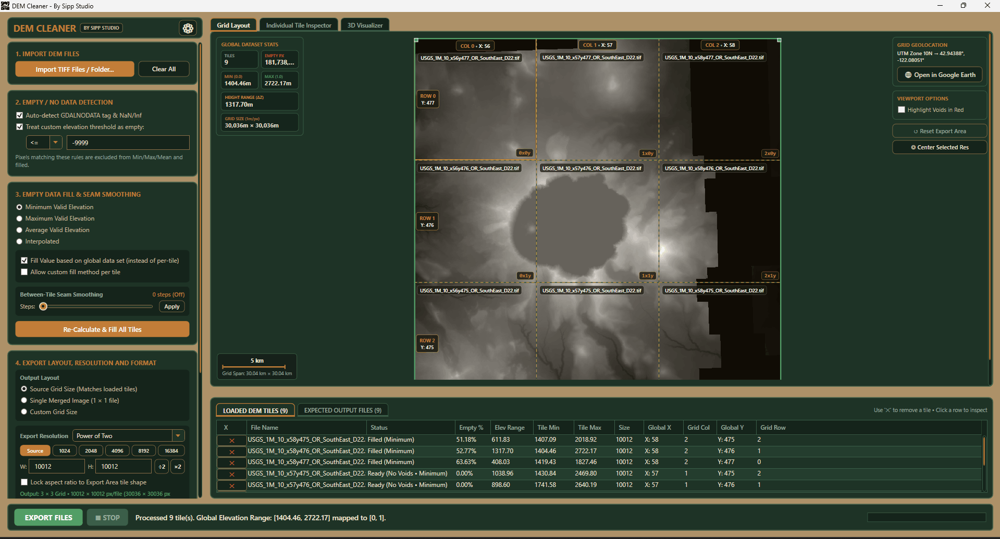
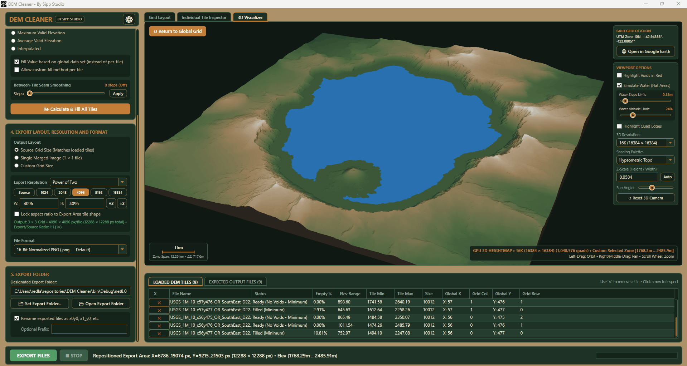
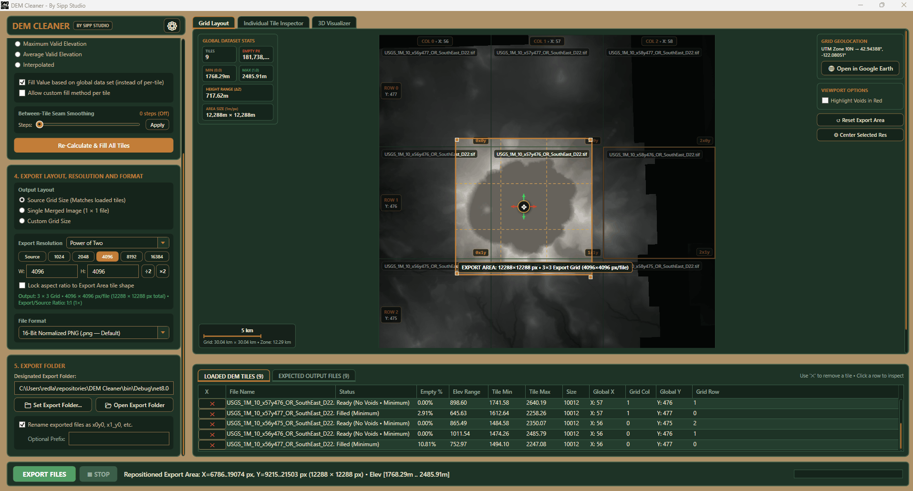

# DEM Cleaner

  

  <strong>Turn raw elevation tiles into clean, continuous terrain heightmaps for games, simulation, and 3D art.</strong>

  
  
  
  
  
  

  

---

**DEM Cleaner** is a Windows desktop tool for inspecting, repairing, stitching, previewing, and exporting digital elevation model (DEM) datasets. It bridges the gap between real-world GIS elevation data (USGS 3DEP, Copernicus, LiDAR) and game engines or DCC applications like **Unreal Engine 5**, **Unity**, **Blender**, **Gaea**, and **Houdini**.

---

## What It Does

- **Consistent Multi-Tile Normalization (0–1 Remapping)**: When working with multi-tile DEM datasets, individual `.tiff` files store real-world elevation in meters. Exporting them separately typically clips or misaligns height ranges, creating broken vertical steps between tiles. DEM Cleaner calculates the true collective min/max elevation bounds across all source tiles relevant to your export region, remapping meters into a synchronized, normalized 16-bit range ($0.0 \dots 1.0$) for perfect vertical alignment in Unreal and Unity.
- **Multi-Tile Mosaic & Auto-Arrangement**: Drag and drop a folder of GeoTIFF elevation tiles. DEM Cleaner arranges them into an interactive continuous mosaic using filename coordinates or embedded geospatial metadata.
- **Void Detection & Repair**: Catches NoData holes, ocean cutouts, and sentinel values. Fill them with your choice of Minimum, Maximum, Mean, or smooth Laplace interpolation.
- **Seam Smoothing**: Eliminates visible elevation steps and harsh seams along tile boundaries with non-destructive feathering.
- **Interactive 2D & 3D Viewports**: Inspect your terrain in a full 2D mosaic view or explore a hardware-accelerated 3D preview with adjustable sun angles, wireframe overlays, and hypsometric color ramps.
- **Custom Crop & Sub-Tile Splitting**: Draw a custom region box to export only the area you need. Split the output into a single merged heightmap, the original tile grid, or custom subdivided tiles.
- **Engine-Ready Presets**: Export directly to standard landscape dimensions for **Unreal Engine** (8129, 4033, 2017) or **Unity** (4097, 2049, 1025) as 16-bit grayscale PNG or 32-bit float GeoTIFF.
- **Helpful UI**: Lots of helfpul statistics and graphs to help users of heighmap worfkows, like the human scale ground reference graph:   

---

## Visual Tour

### 2D Grid Mosaic
View your entire dataset at once with instant stats for tile count, void pixels, elevation span ($\Delta Z$), and physical real-world coverage.

  

### 3D Visualizer
Check slope transitions, lighting, and terrain contours before export. Supports multiple color ramps, wireframe overlays, and elevation exaggeration.

  

### Custom Export Region Crop
Crop any square area with real-time ground distance, effective meters-per-pixel readouts.

  

---

## Getting Started

### Requirements
- **OS**: Windows 10 or Windows 11 (64-bit)
- **Runtime**: [.NET 8.0 Desktop Runtime](https://dotnet.microsoft.com/download/dotnet/8.0)
- **GPU**: DirectX 9+ compatible GPU for 3D preview

### Downloading Elevation Data (USGS DEMs)
Free real-world elevation GeoTIFF datasets can be downloaded from:
- **[USGS The National Map Downloader](https://apps.nationalmap.gov/downloader/)**: The primary tool for acquiring USGS 3DEP elevation data (1-meter LiDAR, 1/3 arc-second ~10m, and 1 arc-second ~30m DEM GeoTIFFs).
- **[USGS EarthExplorer](https://earthexplorer.usgs.gov/)**: Search and download global and domestic elevation coverage (SRTM, ASTER, and 3DEP).
- **[USGS 3D Elevation Program (3DEP)](https://www.usgs.gov/3d-elevation-program)**: Program overview and data access guides.

### Installation
1. Download the latest release from https://github.com/redlaser42/DemCleaner/releases.
2. Extract the archive to any folder.
3. Run `DemCleaner.exe`.

### Basic Workflow
1. **Import**: Drag and drop `.tif` / `.tiff` DEM tiles into the app.
2. **Clean**: Choose a void fill method (e.g., *Interpolated* for terrain holes, *Minimum* for sea level).
3. **Smooth**: Adjust the seam smoothing slider to blend adjacent tile borders.
4. **Crop & Size**: Pick your target resolution preset (Unreal, Unity, or custom size).
5. **Export**: Click **Export Heightmap(s)** to write clean, normalized 16-bit PNGs or GeoTIFFs to your output folder.

---

## License & Credits

**DEM Cleaner is proprietary software.**  
Copyright © Sipp Studio. All rights reserved.

See [LICENSE.txt](LICENSE.txt) for licensing terms. Built with:
- [.NET 8.0 WPF](https://github.com/dotnet/wpf)
- [BitMiracle.LibTiff.NET](https://bitmiracle.com/libtiff/) (BSD-3-Clause)

For technical architecture and developer documentation, see the [docs/](docs/) folder.
