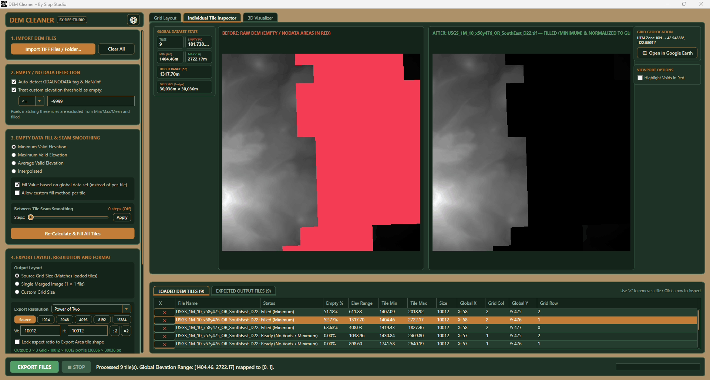
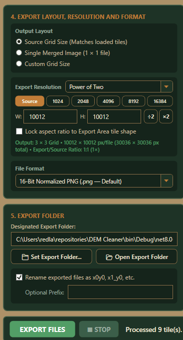

# DEM Cleaner

<p align="center">
  
</p>

<p align="center">
  <strong>Turn raw elevation tiles into clean, continuous terrain heightmaps for games, simulation, and 3D art.</strong>
</p>

<p align="center">
  <a href="https://github.com/sippstudio/dem-cleaner/releases"></a>
  
  
  
  
  <a href="LICENSE.txt"></a>
</p>

<p align="center">
  
</p>

---

**DEM Cleaner** is a Windows desktop application by **Sipp Studio** for importing, inspecting, repairing, stitching, previewing, cropping, and exporting digital elevation model (DEM) data. It bridges the gap between real-world GIS elevation sources (USGS 3DEP, Copernicus, LiDAR) and game engines / DCC tools like **Unreal Engine 5**, **Unity**, **Gaea**, **World Creator**, **Blender**, and **Houdini**.

---

## ⚡ At a Glance

| Stage | Capabilities |
| :--- | :--- |
| **Import & Arrange** | Multi-tile GeoTIFF loading, automatic USGS 1m coordinate detection, tiepoint georeferencing, and scanline/tiled TIFF support. |
| **Clean & Void Fill** | NoData detection (sentinel bounds, GDAL tags, IEEE `NaN`/inf) with 4 filling modes: Minimum, Maximum, Mean, and SOR Laplace interpolation. |
| **Seam Smoothing** | Non-destructive between-tile boundary feathering and multi-step relaxation to remove tile edge steps and elevation tears. |
| **Inspect & Preview** | Real-time 2D mosaic pan/zoom, before/after difference inspection, red void overlays, and GPU Direct3D 3D terrain preview. |
| **Custom Crop & Split** | Interactive square crop gizmo with live scale bar and human-scale reference. Split output as 1×1 merged, original tile grid, or custom $N \times N$. |
| **Engine-Ready Export** | Optimized presets for **Unreal Engine Landscape** (8129, 4033, 2017), **Unity Terrain** (4097, 2049, 1025), and Power-of-Two (8192, 4096, 2048). Outputs Gray16 PNG or GeoTIFF. |

---

## 📸 Interface & Workflow Highlights

### 1. 2D Mosaic & Telemetry Overview
Import single files or entire directories. DEM Cleaner automatically positions tiles into an interactive continuous mosaic using filename coordinate metadata or geospatial tags. The stationary telemetry ribbon displays instant metrics across the entire dataset: loaded tile counts, void pixel totals, elevation ranges ($\Delta Z$), and min/max bounds.

<p align="center">
  
</p>

### 2. Deep Tile Inspection & Void Analysis
Switch to the **Individual Tile Inspector** to examine individual elevation tiles with side-by-side or single-tile views. Identify missing elevation values with high-contrast red void overlays, inspect per-tile elevation histograms, and apply per-tile fill overrides when local conditions require specialized handling.

<p align="center">
  
</p>

### 3. Interactive Hardware-Accelerated 3D Visualizer
Preview your repaired terrain in an interactive 3D viewport powered by WPF Direct3D. Evaluate slope transitions and seam blending under customizable sun angles and light intensities. Choose from multiple hypsometric palettes (Hypsometric, Grayscale, Alpine, Desert), adjust elevation exaggeration ($Z$-scale), and toggle optional wireframe or water plane overlays.

<p align="center">
  
</p>

> [!NOTE]
> The 3D viewer supports preview quality tiers from **1K** up to **16K**. The 16K tier maximizes mesh density and sampling fidelity for terrain evaluation (the preview viewport texture itself is capped at 8192×8192 for GPU stability).

### 4. Custom Region Crop & Dynamic Scale Matrix
Crop exactly the terrain footprint your project needs using an interactive square crop box with center gizmo, edge handles, and real-time dimension readouts. The viewport features an adaptive distance scale bar and a human-scale silhouette ($1.80\,\text{m}$) to give immediate real-world perspective.

<p align="center">
  
</p>

### 5. Production Game Engine Presets
Avoid manual heightmap math. DEM Cleaner features built-in resolution preset matrices specifically calibrated for game engine landscape components and terrain systems.

<p align="center">
  
</p>

| Workflow Target | Recommended Preset Resolutions | Output Format |
| :--- | :--- | :--- |
| **Unreal Engine 5** | `8129 × 8129`, `4033 × 4033`, `2017 × 2017`, `1009 × 1009`, `505 × 505` | 16-bit Grayscale PNG |
| **Unity Terrain** | `4097 × 4097`, `2049 × 2049`, `1025 × 1025`, `513 × 513` | 16-bit Grayscale PNG / RAW |
| **Power-of-Two (DCC)** | `8192 × 8192`, `4096 × 4096`, `2048 × 2048`, `1024 × 1024` | 16-bit PNG / GeoTIFF |
| **GIS / Scientific** | Source native resolution or custom dimensions | 32-bit Float GeoTIFF |

---

## 🛠️ Core Algorithms & Processing Capabilities

### Void Detection
Real-world DEMs frequently contain water bodies, cloud occlusions, or sensor dropouts represented by missing values. DEM Cleaner identifies voids through three simultaneous filters:
1. **IEEE Non-Finite Values**: Catches `NaN`, `+Infinity`, and `-Infinity` floating-point values.
2. **Sentinel Extremes**: Detects standard GIS sentinel values ($\le -1\times 10^{30}$ and $\ge 1\times 10^{30}$).
3. **GDAL / GeoTIFF Tags & Custom Thresholds**: Reads embedded tag `42113` (NoData string) or applies user-specified numeric comparisons (`≤`, `=`, `≥`).

### 4 Void Filling Modes
- **Minimum**: Replaces voids with the dataset or tile minimum valid elevation. Ideal for ocean basins or low-lying water bodies.
- **Maximum**: Sets voids to peak elevations.
- **Mean**: Sets voids to average local elevation.
- **Interpolated (Gauss-Seidel SOR Laplace)**: Seeds void perimeters from adjacent valid data and iteratively solves Laplace's equation using Successive Over-Relaxation (SOR) with an acceleration factor $\omega = 1.35$. Produces smooth, continuous transitions across complex holes.

### Non-Destructive Seam Smoothing
Neighboring DEM tiles often exhibit subtle edge offsets due to differing acquisition times, projection sampling, or datum variations. DEM Cleaner's seam-smoothing pipeline feathers elevation differences across adjacent borders using smoothstep transitions and cross-boundary relaxation. 

> [!TIP]
> Smoothing is non-destructive: the original void-filled state is cached in `BaseFilledData`, allowing you to adjust seam smoothing steps repeatedly without compounding edits.

---

## 🚀 Getting Started

### System Requirements
- **Operating System**: Windows 10 or Windows 11 (64-bit).
- **Runtime**: [Microsoft .NET 8.0 Desktop Runtime (x64)](https://dotnet.microsoft.com/download/dotnet/8.0).
- **GPU**: DirectX 9 / Direct3D compatible GPU for hardware-accelerated 3D preview.
- **Memory**: 8 GB RAM minimum; 16+ GB recommended for large multi-tile 1-meter DEM mosaics.

### Download & Run (Packaged Release)
1. Go to the [Releases](https://github.com/sippstudio/dem-cleaner/releases) page.
2. Download the latest `DemCleaner-v1.0.0-win-x64.zip`.
3. Extract the ZIP archive to a folder of your choice.
4. Launch `DemCleaner.exe`.

### Build from Source
Requires the [.NET 8.0 SDK](https://dotnet.microsoft.com/download/dotnet/8.0) with Windows Desktop workload.

```powershell
# Clone the repository
git clone https://github.com/sippstudio/dem-cleaner.git
cd dem-cleaner

# Compile Release build
dotnet build DemCleaner.csproj -c Release

# Run the application
./bin/Release/net8.0-windows/DemCleaner.exe
```

> [!NOTE]
> Always compile with `-c Release`. The `Debug` configuration includes a post-build hook configured for local Visual Studio debugging that auto-launches the GUI.

---

## 📖 Step-by-Step Workflow


1. **Import**: Drag and drop `.tif` / `.tiff` DEM files into the window or click **Browse Files** / **Browse Folder**.
2. **Review Layout**: Confirm the automatic grid arrangement. Re-order grid columns/rows in the bottom table if dealing with non-standard naming schemes.
3. **Configure Void Repair**: Select your preferred void filling algorithm (e.g., *Interpolated* for missing terrain patches or *Minimum* for sea-level voids).
4. **Smooth Seams**: Adjust the seam smoothing steps slider while observing boundaries in the 2D viewer or 3D visualizer.
5. **Crop & Select Resolution**: Check **Enable Custom Area Selection** to crop a square region, or export the entire merged mosaic. Choose an Unreal Engine, Unity, or Power-of-Two preset.
6. **Export**: Review the generated filenames, coordinates, and normalization ranges in the **EXPECTED OUTPUT FILES** tab, then click **Export Heightmap(s)**.

---

## 🎨 Built-in Color Themes

Customize the editor to match your studio workflow or lighting environment via the ⚙ (Settings) button in the top-right header:
- **Sage & Sandstone** (Default balanced earth tone)
- **Topo Buckskin & Olive** (Warm cartographic palette)
- **Canyon & Pine** (High-contrast outdoor motif)
- **Forest Canopy** (Deep woodland theme)
- **Desert Mesa** (Warm arid gradient)
- **Midnight Slate** (Dark low-fatigue studio theme)

---

## 🛠️ Repository & Developer Utilities

| Path / Tool | Purpose |
| :--- | :--- |
| [`scripts/build-release.ps1`](scripts/build-release.ps1) | One-command release packaging script. Publishes the app, runs self-tests, copies licenses, and creates `release/DemCleaner-v<version>-win-x64.zip`. |
| [`scripts/capture-screenshots.ps1`](scripts/capture-screenshots.ps1) | Win32 utility to automatically capture high-resolution window screenshots of running DEM Cleaner views. |
| [`images/README.md`](images/README.md) | Visual asset documentation detailing screenshot dimensions, target tabs, and update procedures. |
| [AGENTS.md](AGENTS.md) | Architectural invariants, Git safety rules, and operational guidelines for AI coding agents. |
| [ARCHITECTURE.md](ARCHITECTURE.md) | In-depth technical architecture, memory model, and algorithm specifications. |
| [DEVELOPMENT.md](DEVELOPMENT.md) | Development environment setup, test execution, and debugging guides. |

### Running the Headless Smoke Test
Verify basic assembly defaults and theme registrations:
```powershell
./bin/Release/net8.0-windows/DemCleaner.exe --self-test
Get-Content ./bin/Release/net8.0-windows/selftest_result.txt
```

---

## 📄 License & Attribution

**DEM Cleaner is proprietary software.**  
Copyright © Sipp Studio. All rights reserved.

See [LICENSE.txt](LICENSE.txt) for licensing terms. Built with:
- [.NET 8.0 WPF](https://github.com/dotnet/wpf)
- [BitMiracle.LibTiff.NET](https://bitmiracle.com/libtiff/) (BSD-3-Clause)
