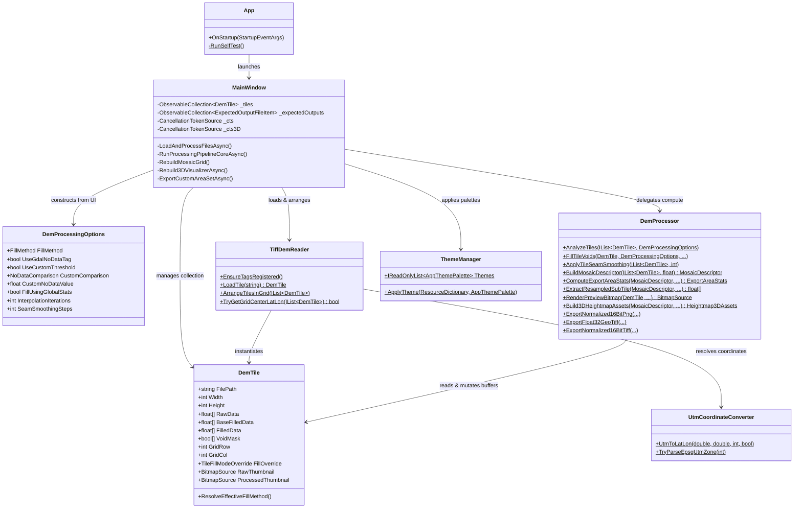
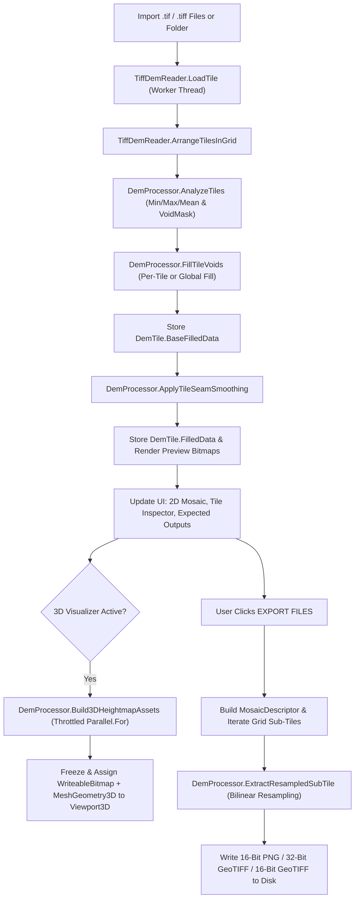

# ARCHITECTURE.md — Technical Reference for DEM Cleaner

This document provides a technical reference for the **DEM Cleaner** architecture, data structures, algorithms, and pipelines as verified from the repository source code.

---

## 1. Project Overview

**DEM Cleaner** is a Windows desktop application built by Sipp Studio for GIS and 3D terrain pipelines (such as Unreal Engine Landscape, Unity Terrain, and Gaea). It ingests single or tiled Digital Elevation Model (DEM) GeoTIFF files, detects and repairs missing/void elevation data, smooths seams across adjacent tiles, previews the resulting mosaic in 2D and hardware-accelerated 3D, and exports cropped/resampled elevation datasets as 16-bit normalized PNGs, 16-bit normalized GeoTIFFs, or 32-bit floating-point GeoTIFFs.

### Verified Capabilities
- **TIFF Decoding**: Scanline and tiled TIFFs; 8/16/32/64-bit integer and IEEE float samples via managed LibTiff.
- **Metadata Extraction**: Reads and parses `GDAL_NODATA` (`42113`), `ModelPixelScaleTag` (`33550`), `ModelTiepointTag` (`33922`), `GeoKeyDirectoryTag` (`34735`), and `GeoAsciiParamsTag` (`34737`).
- **Tile Grid Arrangement**: Automatic placement using USGS 1m filename patterns (`USGS_1M_10_x56y475`), generic `x/y` or `r/c` filename coordinates, GeoTIFF tiepoints, or near-square alphabetical fallback.
- **Void Detection & Filling**: Identifies voids via sentinel floats ($\le -1e30$), `NaN`/`Infinity`, GDAL tag, or custom thresholds. Fills voids via Minimum, Maximum, Mean, or Wavefront seeding + Gauss-Seidel SOR Laplace relaxation.
- **Seam Smoothing**: Multi-pass cross-boundary smoothing (tangential 1D box filter + smoothstep jump feathering + C1 cross-boundary Laplacian relaxation).
- **Interactive Viewports**: 2D mosaic viewport (zoom, pan, square crop area selection, translation gizmo, metric scale bar) and Before/After tile inspector.
- **3D GPU Heightmap Visualizer**: Hardware-accelerated WPF `Viewport3D` with 1K–16K resolution tiers, 4 color palettes, flat-water shading, quad wireframe, sun azimuth lighting, and automatic/manual Z-scale.
- **Bilinear Resampling & Export**: Exports merged single images, source grids, or custom $N \times N$ layouts to 16-bit PNG, 32-bit float GeoTIFF, or 16-bit GeoTIFF with game-engine resolution presets.

---

## 2. Technology Stack

| Component | Technology | Role & Notes |
| :--- | :--- | :--- |
| **Runtime & Language** | C# 12 / .NET 8.0 (`net8.0-windows`) | `<Nullable>enable</Nullable>`, `<ImplicitUsings>enable</ImplicitUsings>` |
| **UI Framework** | Windows Presentation Foundation (WPF) | Dynamic resource theming, custom templates, Direct3D 9 interop via `Viewport3D` |
| **TIFF Engine** | `BitMiracle.LibTiff.NET` (2.4.660) | Managed LibTiff implementation (`BitMiracle.LibTiff.Classic`) with custom tag extender |
| **PNG Encoding** | `System.Windows.Media.Imaging` | `PngBitmapEncoder` with `PixelFormats.Gray16` (`ushort[]` buffer) |
| **Concurrency** | `Task.Run` + `Parallel.For` | Background worker pipelines throttled to `ProcessorCount / 2` to preserve UI responsiveness |

---

## 3. Directory & File Structure

```text
DEM Cleaner/
├── DemCleaner.csproj               # .NET 8 WPF project file with Debug PostBuild launch hook
├── DemCleaner.slnx                 # Solution file
├── LICENSE.txt                     # Proprietary software license (copied to build output)
├── README.md                       # Consumer project documentation and visual tour
├── AGENTS.md                       # AI agent operational reference and critical invariants
├── docs/                           # Architecture, development workflows, and release notes
├── images/                         # Application icons (icon.png, icon2.ico) and preview screenshots
├── Properties/
│   └── AssemblyInfo.cs             # WPF ThemeInfo configuration
├── Views/
│   ├── App.xaml / App.xaml.cs      # Application startup and headless --self-test CLI runner
│   └── MainWindow.xaml / .cs       # Primary window: UI layout, viewport canvas, 3D camera, pipelines
├── Models/
│   └── DemTile.cs                  # DemTile, DemProcessingOptions, ExpectedOutputFileItem, enums
└── Services/
    ├── DemProcessor.cs             # Stateless computational engine: void fill, smoothing, export, 3D
    ├── ThemeManager.cs             # AppThemePalette definition and 6 runtime color schemes
    ├── TiffDemReader.cs            # TIFF decoding, GeoTIFF tag extender, filename coordinate parsing
    ├── UserSettingsService.cs      # User settings model and persistent JSON storage in %APPDATA%
    └── UtmCoordinateConverter.cs   # WGS84/NAD83 UTM coordinate math and EPSG PCS code parsing
```

---

## 4. Major Components & Responsibilities



### Component Details
1. **[Views/MainWindow.xaml.cs](../Views/MainWindow.xaml.cs)**: Main UI controller. Manages UI event routing, 2D viewport pan/zoom transforms, custom square crop gizmo interactions, 3D orbit/pan camera math, and async task orchestration via `_cts` and `_cts3D`.
2. **[Models/DemTile.cs](Models/DemTile.cs)**: Data carrier implementing `INotifyPropertyChanged`. Contains tile dimensions, geographic metadata, and the three distinct elevation buffers (`RawData`, `BaseFilledData`, `FilledData`).
3. **[Services/TiffDemReader.cs](Services/TiffDemReader.cs)**: Decodes scanline and tiled TIFFs into row-major float arrays. Implements `TagExtender` for custom GeoTIFF/GDAL tags. Arranges tiles by filename coordinates, tiepoints, or near-square alphabetical order.
4. **[Services/DemProcessor.cs](Services/DemProcessor.cs)**: Pure static compute engine. Performs statistical analysis, void filling, seam smoothing, virtual mosaic indexing, bilinear resampling, preview bitmap rendering, 3D mesh/texture generation, and file export.
5. **[Services/UtmCoordinateConverter.cs](Services/UtmCoordinateConverter.cs)**: Provides closed-form UTM Easting/Northing to WGS84 Latitude/Longitude conversion using ellipsoidal series expansion and maps EPSG PCS codes.
6. **[Services/ThemeManager.cs](Services/ThemeManager.cs)**: Supplies 6 color palette records and mutates `Window.Resources` dynamically with frozen `SolidColorBrush` instances.

---

## 5. Data Flow & Algorithmic Pipelines



### 1. Void Pixel Analysis (`AnalyzeTiles`)
- Computes per-tile and dataset-wide valid elevation statistics (`Min`, `Max`, `Mean`).
- Populates `DemTile.VoidMask` (`bool[]`) using `IsVoidPixel`:
  - Values matching `NaN`, `Infinity`, or sentinel extrema ($\le -1e30f$ or $\ge 1e30f$).
  - GDAL NoData tag match within tolerance: $\text{tol} = \max(1e-4, |\text{NoData}| \times 1e-5)$.
  - Custom threshold comparison (`<=`, `==`, `>=`).

### 2. Void Filling (`FillTileVoids`)
- **Constant Modes (Minimum, Maximum, Mean)**: Replaces void pixels with either the per-tile statistic or the global dataset statistic (`FillUsingGlobalStats`).
- **Wavefront + SOR Laplace Interpolation (`InterpolateVoidsInPlace`)**:
  - *Pass 1 (Wavefront Propagation)*: Inward 8-neighbor distance-weighted propagation from valid borders initializes void pixels across arbitrary gap sizes.
  - *Pass 2 (Gauss-Seidel SOR Laplace)*: Successive Over-Relaxation ($\omega = 1.45$) relaxes void pixels until maximum delta falls below $1e-4f$ or iteration limit is reached.
- Result is saved to both `BaseFilledData` and `FilledData`.

### 3. Inter-Tile Seam Smoothing (`ApplyTileSeamSmoothing`)
- Always restores `FilledData` from `BaseFilledData` before processing, ensuring idempotent and repeatable smoothing.
- *Pass 1 & 2 (C0 Step Feathering)*: Evaluates edge elevation differences across vertical and horizontal seams, filters differences tangentially with a 1D box filter (`Smooth1DArray`), and applies smoothstep falloff $t^2(3 - 2t)$ across boundary bands.
- *Pass 3 (C1 Laplacian Relaxation)*: Performs iterative 4-neighbor cross-boundary relaxation across vertical and horizontal seams for tiles with matching dimensions.

### 4. Virtual Mosaic & Bilinear Resampling (`ExtractResampledSubTile`)
- `MosaicDescriptor` maps multi-tile grids without allocating a monolithic composite buffer in RAM.
- Maps continuous sub-tile normalized coordinates $[0..1]$ to source mosaic space and samples elevations via bilinear interpolation between adjacent pixel centers.

### 5. 3D GPU Heightmap Generation (`Build3DHeightmapAssets`)
- Generates a shaded albedo texture (`WriteableBitmap`) and displaced terrain geometry (`MeshGeometry3D`) with a geological base skirt.
- Scales normal strength and mesh tessellation with resolution tier:
  - 1K: 4,096 quads ($64 \times 64$)
  - 2K: 16,384 quads ($128 \times 128$)
  - 4K: 65,536 quads ($256 \times 256$)
  - 8K: 262,144 quads ($512 \times 512$)
  - 16K: 1,048,576 quads ($1024 \times 1024$), texture capped at $8192 \times 8192$ (Direct3D 9 hardware limit) with $1/16384$ sub-pixel micro-normal sampling.
- All generated WPF 3D assets are frozen (`.Freeze()`) before returning to the UI thread.

---

## 6. Architectural Invariants

The following conditions are verified design guarantees that must be maintained:

1. **Elevation Buffer Separation**:
   - `RawData` is immutable after initial load.
   - `BaseFilledData` represents void-filled elevations *prior* to inter-tile seam smoothing.
   - `FilledData` holds active elevations *after* seam smoothing. `ApplyTileSeamSmoothing` must always begin by resetting `FilledData` from `BaseFilledData`.
2. **Virtual Mosaic Indexing**:
   - Multi-tile processing and export must remain virtualized through `MosaicDescriptor`. Full-mosaic allocations in RAM are prohibited.
3. **Coordinate Transformation Accuracy**:
   - Geographic coordinates must follow WGS84 conventions. When arranging grids by geographic Y coordinates (e.g., USGS northing), larger Y values represent North and must map to row index 0 (top of the grid).
4. **GeoTIFF Tag Registration**:
   - Custom tags must be registered via `TiffDemReader.EnsureTagsRegistered()` prior to opening any TIFF handle.
5. **Preview & Export Symmetry**:
   - The file list, grid coordinates, dimensions, and naming produced in `MainWindow.UpdateExpectedOutputFilesList` must remain identical to the actual files emitted by `MainWindow.ExportCustomAreaSetAsync`.
6. **Thread Affinity & Freezable Immutability**:
   - Any `Freezable` created on a background worker thread and dispatched to the UI must be frozen using `.Freeze()`. Objects must only be frozen when no subsequent mutation is required.
7. **Independent Cancellation Lifecycles**:
   - Main compute pipelines (`_cts`) and 3D preview builds (`_cts3D`) must operate on independent cancellation tokens to prevent 3D parameter adjustments from cancelling ongoing file exports or void-filling tasks.
8. **Asynchronous State Consistency**:
   - Cancellation must leave the application in a consistent, non-busy state (`SetBusy(false)`), preserving loaded tiles without corrupting buffers.

---

## 7. Architectural Risks & Technical Debt

1. **Monolithic UI Controller**:
   - [MainWindow.xaml.cs](MainWindow.xaml.cs) acts as a central coordinator combining UI interactions, 2D canvas overlay drawing, 3D camera transforms, and background workflow dispatching.
   - *Impact*: High regression risk when modifying unrelated features.
   - *Recommendation*: Incrementally extract domain responsibilities (such as export coordination and 2D overlay rendering) into focused services.
2. **In-Memory Elevation Buffer Footprint**:
   - Each tile maintains `RawData` (`float[]`), `BaseFilledData` (`float[]`), `FilledData` (`float[]`), and `VoidMask` (`bool[]`) simultaneously in RAM (~13 bytes per pixel).
   - *Impact*: Datasets containing dozens of $10{,}000 \times 10{,}000$ tiles can exceed system memory.
   - *Recommendation*: Consider on-demand disk caching or discarding intermediate `BaseFilledData` when seam smoothing is disabled.
3. **Direct3D 9 Texture Hardware Cap**:
   - WPF's `Viewport3D` is constrained by Direct3D 9 hardware limits, capping texture bitmaps to $8192 \times 8192$.
   - *Impact*: The "16K" 3D preview tier renders geometry tessellated to 1,048,576 quads, but uses an 8K texture with sub-pixel sampling rather than a true 16K texture map.
4. **Seam Smoothing Tile Dimension Constraint**:
   - Pass 3 of `ApplyTileSeamSmoothing` (cross-boundary Laplacian relaxation) requires adjacent tiles to have identical width and height. Tiles with differing resolutions only receive Pass 1 and 2 step feathering.

---

## 8. Incremental Refactoring Guidance

When extending or cleaning the codebase:
- **Avoid Wholesale Rewrites**: Do not attempt a full rewrite or force an MVVM framework into the project. The code-behind + static service pattern is established and functional.
- **Isolate Computational Logic**: Place all new mathematical, GIS, or file I/O operations into `Services/` as pure static or injectable methods that do not depend on WPF UI controls.
- **Extract Responsibilities Incrementally**: When modifying [MainWindow.xaml.cs](MainWindow.xaml.cs), look for opportunities to extract cohesive helper classes (e.g., `ExportCoordinator`, `ViewportCameraController`) with clear inputs and outputs.
- **Verify Invariants**: Any architectural refactoring must be accompanied by build verification (`dotnet build -c Release`) and regression testing of tile loading, void filling, and export.
